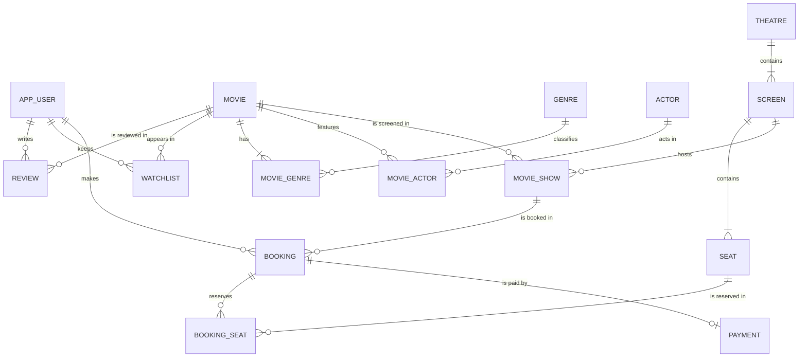

# Movie Discovery, Review & Cinema Booking Database
## Phase 1 Design Document (Steps 1–4)

**Tech:** Oracle SQL / PL/SQL, SQL Developer
**Scope of Phase 1:** a standalone database demonstrated entirely in SQL Developer.

> **Two naming changes from the suggested table list**
> - `USER` → **`APP_USER`**. `USER` is a reserved word in Oracle (it is a built-in function returning the current schema name). Creating a table called `USER` fails.
> - `SHOW` → **`MOVIE_SHOW`**. `SHOW` is a SQL\*Plus/SQL Developer script command, so a line starting with it can be misinterpreted when running scripts. `MOVIE_SHOW` avoids the confusion and is more descriptive.

---

## STEP 1 — REQUIREMENTS

### 1.1 Problem Statement

Movie lovers currently use one kind of application to discover and review films (like Letterboxd) and a completely different one to book cinema tickets (like BookMyShow). The data about what a person likes and what they actually go to watch is therefore split across systems.

This project designs a single relational database that stores movie information (genres, cast), user activity (ratings, reviews, watchlists) and cinema operations (theatres, screens, seats, shows, bookings, payments). The database must enforce the important rules of the domain, such as "a seat cannot be sold twice for the same show", using constraints and a small amount of PL/SQL, and must support meaningful SQL queries across both halves of the domain.

### 1.2 Objectives

1. Design a correct ER/EER model for the domain and map it to relations.
2. Normalize the schema to 3NF and justify every design decision using functional dependencies.
3. Enforce data integrity declaratively (PK, FK, UNIQUE, NOT NULL, CHECK) wherever possible, and use triggers only where a constraint cannot express the rule.
4. Populate the database with a small, realistic dataset that makes queries interesting.
5. Demonstrate the undergraduate SQL syllabus (joins, grouping, subqueries, set operators, views, transactions) on real project questions.

### 1.3 Functional Requirements

| ID | Requirement |
|----|-------------|
| FR1 | Store user profiles (username, name, email, phone, city, date of birth, join date). |
| FR2 | Store movies with title, release date, duration, language, certificate and description. |
| FR3 | Assign one or more genres to each movie. |
| FR4 | Record the actors in each movie along with the character they play. |
| FR5 | Allow a user to rate a movie and optionally write a review. |
| FR6 | Allow a user to add movies to a personal watchlist. |
| FR7 | Store theatres, the screens inside each theatre, and the seats inside each screen. |
| FR8 | Schedule shows: a given movie on a given screen at a given date and time with a base ticket price. |
| FR9 | Allow a user to book one or more seats for a show. |
| FR10 | Record payment information for a booking. |
| FR11 | Report on ratings, reviews, show schedules, seat availability and bookings. |

### 1.4 Business Rules

Each rule is listed together with **how the database enforces it**. This table is very useful in the viva.

| # | Business Rule | Enforced by |
|---|---------------|-------------|
| BR1 | Username and email are unique per user. | `UNIQUE` |
| BR2 | A user can review a particular movie **at most once** (they can edit it, not add a second one). | Composite `PRIMARY KEY (user_id, movie_id)` on `REVIEW` |
| BR3 | A rating is between 0.5 and 5.0 in steps of 0.5 (Letterboxd-style half stars). | `CHECK` |
| BR4 | A movie appears at most once in a given user's watchlist. | Composite PK on `WATCHLIST` |
| BR5 | A movie's certificate is one of U, UA, A, S (Indian CBFC categories). | `CHECK` |
| BR6 | Screen numbers are unique within a theatre (Screen 1, Screen 2…). | `UNIQUE (theatre_id, screen_no)` |
| BR7 | A seat label (row + number) is unique within a screen. | `UNIQUE (screen_id, seat_row, seat_number)` |
| BR8 | Two shows cannot start on the same screen at the same time. | `UNIQUE (screen_id, show_start)` |
| BR9 | A booking must be for an existing user and an existing show. | `FOREIGN KEY` |
| BR10 | A seat cannot be booked twice for the same show. | `UNIQUE (show_id, seat_id)` on `BOOKING_SEAT` |
| BR11 | A booked seat must belong to the screen on which the show is running. | Trigger `TRG_BOOKING_SEAT_SCREEN` (no constraint can express a check across two other tables) |
| BR12 | Booking status ∈ {PENDING, CONFIRMED, CANCELLED}. | `CHECK` |
| BR13 | Each booking has at most one payment record. | `UNIQUE (booking_id)` on `PAYMENT` |
| BR14 | Payment status ∈ {PENDING, SUCCESS, FAILED, REFUNDED}; a SUCCESS/REFUNDED payment must have a payment time. | `CHECK` (multi-column) |
| BR15 | Premium seats cost ₹100 more than the show's base price. The price actually charged is stored per seat at the time of booking. | Sample data / booking procedure (Phase 1 PL/SQL) |
| BR16 | When a booking is cancelled, its seats are released (its `BOOKING_SEAT` rows are removed) and the booking row stays with status CANCELLED for history. | Cancellation procedure (PL/SQL step) |

### 1.5 Scope

**In scope (Phase 1):** schema design, DDL, constraints, sample data, SQL queries, views, simple triggers/procedures/functions, transactions — everything runnable in SQL Developer.

**Out of scope (Phase 1):** frontend, backend/APIs, login and passwords, real payment gateways, seat locking with timeouts, dynamic pricing, recommendations, follower/social features, and overlapping-show detection based on movie duration.

### 1.6 Assumptions

1. All theatres are in India, prices are in INR and times are local (Oracle `DATE`, which stores date and time).
2. One show = one movie on one screen at one start time. Language/format variations (e.g. RRR in Hindi) would be separate movie rows or ignored for simplicity.
3. A seat's type (REGULAR/PREMIUM) is fixed for the screen, not per show.
4. A booking belongs to exactly one show (you cannot mix seats from two shows in one booking).
5. Payment is modelled as a single record per booking; retries overwrite status rather than creating new rows.
6. Users can review any movie, including ones they did not book through this system (like Letterboxd).
7. IDs are assigned explicitly in the sample data; sequences are provided for new bookings/payments.

---

## STEP 2 — ER / EER DESIGN

### 2.1 Entities

| Entity | Why it exists | Important attributes | Primary key |
|--------|---------------|----------------------|-------------|
| **APP_USER** | People who rate, review, watchlist and book. | username, full_name, email, phone, city, date_of_birth, joined_on | user_id |
| **MOVIE** | Central entity of the discovery half. | title, release_date, duration_min, movie_language, certificate, description | movie_id |
| **GENRE** | A movie has several genres; storing them as a comma list would violate 1NF. | genre_name | genre_id |
| **ACTOR** | Actors appear in many movies; storing them once avoids repeating names. | actor_name, nationality | actor_id |
| **THEATRE** | A physical cinema. | theatre_name, city, address | theatre_id |
| **SCREEN** *(weak)* | An auditorium inside a theatre. "Screen 2" means nothing without saying which theatre. | screen_no *(partial key)*, screen_type | screen_id (surrogate) |
| **SEAT** *(weak)* | A physical seat in a screen. "B4" only makes sense inside a screen. | seat_row, seat_number *(partial key)*, seat_type | seat_id (surrogate) |
| **MOVIE_SHOW** | A scheduled screening. Bookings are made for shows, not for movies. | show_start, base_price | show_id |
| **BOOKING** | One purchase by one user for one show. | booking_time, status | booking_id |
| **PAYMENT** | Payment details for a booking; kept separate because a booking can exist before payment (PENDING) and payment has its own attributes. | amount, payment_method, payment_status, paid_at | payment_id |

**Associative entities** (created from M:N relationships that have their own attributes):

| Associative entity | Connects | Own attributes | Primary key |
|--------------------|----------|----------------|-------------|
| **MOVIE_GENRE** | MOVIE – GENRE | — | (movie_id, genre_id) |
| **MOVIE_ACTOR** | MOVIE – ACTOR | character_name | (movie_id, actor_id) |
| **REVIEW** | APP_USER – MOVIE | rating, review_text, review_date | (user_id, movie_id) |
| **WATCHLIST** | APP_USER – MOVIE | added_on | (user_id, movie_id) |
| **BOOKING_SEAT** | BOOKING – SEAT | price_paid (and show_id, see 2.4) | (booking_id, seat_id) |

### 2.2 Relationships

Participation: **Total** = every instance must participate (mandatory); **Partial** = optional.

| Relationship | Between | Cardinality | Participation | FK mapping |
|--------------|---------|-------------|---------------|------------|
| BELONGS_TO | MOVIE – GENRE | **M:N** | Movie: total *(business rule, see note)*; Genre: partial (a genre like Romance may have no movies yet) | MOVIE_GENRE(movie_id → MOVIE, genre_id → GENRE) |
| ACTS_IN | ACTOR – MOVIE | **M:N** | Both partial (an animated film may have no actors stored) | MOVIE_ACTOR(movie_id, actor_id) |
| REVIEWS | APP_USER – MOVIE | **M:N** | Both partial | REVIEW(user_id, movie_id) |
| WATCHLISTS | APP_USER – MOVIE | **M:N** | Both partial | WATCHLIST(user_id, movie_id) |
| HAS_SCREEN *(identifying)* | THEATRE – SCREEN | 1:N | Screen: **total**; Theatre: total (a theatre has ≥1 screen, business rule) | SCREEN.theatre_id NOT NULL → THEATRE |
| HAS_SEAT *(identifying)* | SCREEN – SEAT | 1:N | Seat: **total**; Screen: total (business rule) | SEAT.screen_id NOT NULL → SCREEN |
| SCREENS | MOVIE – MOVIE_SHOW | 1:N | Show: total; Movie: partial (old movies have no shows) | MOVIE_SHOW.movie_id NOT NULL → MOVIE |
| HOSTS | SCREEN – MOVIE_SHOW | 1:N | Show: total; Screen: partial | MOVIE_SHOW.screen_id NOT NULL → SCREEN |
| MAKES | APP_USER – BOOKING | 1:N | Booking: total; User: partial | BOOKING.user_id NOT NULL → APP_USER |
| FOR_SHOW | MOVIE_SHOW – BOOKING | 1:N | Booking: total; Show: partial | BOOKING.show_id NOT NULL → MOVIE_SHOW |
| RESERVES | BOOKING – SEAT | **M:N** (over time a seat is booked in many bookings; a booking has many seats) | Seat: partial; Booking: partial (a cancelled booking has no seats) | BOOKING_SEAT(booking_id, seat_id) |
| PAID_BY | BOOKING – PAYMENT | **1:1** | Payment: total; Booking: partial (payment may not exist yet) | PAYMENT.booking_id NOT NULL UNIQUE → BOOKING |

> **Note on "total" participation from the "one" side.** Rules like "every movie has at least one genre" or "every theatre has at least one screen" cannot be enforced by a foreign key, because the FK sits in the *other* table. We state them as business rules and would enforce them in the insertion procedure. This is a good point to mention in the viva: FKs enforce total participation only on the side that holds the FK.

### 2.3 Why this design (and where it differs from the suggested structure)

1. **Rating and review are one relation.** In Letterboxd a rating and a written review are the same "log" of a film by a user. Keeping them together in `REVIEW` with `review_text` nullable allows rating-only entries and avoids a second table with the same key `(user_id, movie_id)`.

2. **SCREEN and SEAT are weak entities in the ER diagram but get surrogate keys in the relational schema.** Strictly, the key of SEAT would be `(theatre_id, screen_no, seat_row, seat_number)`, and BOOKING_SEAT would then need a 4-column foreign key. We keep the weak-entity idea visible by making the natural keys `UNIQUE NOT NULL` (so they are **candidate keys**) while using `screen_id` and `seat_id` as primary keys. This is a standard, defensible mapping choice.

3. **`SHOW ---- BOOKING ---- USER` is not an M:N relationship.** BOOKING is a real entity with its own identity and 1:N relationships to both USER and SHOW, not an associative table: the same user can book the same show twice (e.g. two separate purchases), so `(user_id, show_id)` cannot be its key.

4. **BOOKING_SEAT carries `show_id` on purpose.** The rule "a seat cannot be booked twice for the same show" needs a constraint on `(show_id, seat_id)`. But `show_id` lives in BOOKING, not in BOOKING_SEAT. Copying `show_id` into BOOKING_SEAT lets us write:
   - `UNIQUE (show_id, seat_id)` → prevents double booking without any PL/SQL;
   - `FOREIGN KEY (booking_id, show_id) REFERENCES BOOKING(booking_id, show_id)` → guarantees the copied `show_id` always matches the booking's show, so the copy can never become inconsistent.

   (BOOKING has an extra `UNIQUE (booking_id, show_id)` just so this composite FK has something to reference.) The normalization consequence is discussed in Step 4.4.

5. **PAYMENT is 1:1 with BOOKING.** A separate table is justified because payment has its own lifecycle (a booking exists before it is paid) and attributes that would be NULL for unpaid bookings.

6. **No `capacity` column in SCREEN and no `total_amount` column in BOOKING.** Both are derivable (`COUNT` of seats, `SUM` of `price_paid`). Storing them would create update anomalies; views compute them instead.

7. **`price_paid` is stored in BOOKING_SEAT.** This is *not* redundancy: it records the price at the moment of purchase. If the theatre later changes the show price, old bookings must keep their original price.

### 2.4 EER: Seat specialization

SEAT is specialised into **REGULAR_SEAT** and **PREMIUM_SEAT**:

- **Attribute-defined** on `seat_type`
- **Disjoint** (a seat is exactly one type)
- **Total** (every seat is one of the two)

Since the subclasses have **no attributes of their own** (the price difference is a rule, not stored data), we map the specialization to a **single table with a type discriminator** (`seat_type` with a CHECK constraint). This is the standard mapping option when subclasses add no attributes; creating two extra tables would add joins with no benefit.

### 2.5 ER diagram (Mermaid)

Paste this into any Mermaid renderer (mermaid.live) to draw the diagram, then redraw it in Chen notation for the report if your instructor requires it.



---

## STEP 3 — RELATIONAL SCHEMA

Notation: **PK** primary key, **FK** foreign key, **UQ** unique, **NN** not null, **CK** check.

```
APP_USER(
    user_id        PK
    username       NN, UQ
    full_name      NN
    email          NN, UQ, CK (looks like an email)
    phone          UQ (nullable)
    city
    date_of_birth
    joined_on      NN, default SYSDATE
)
Candidate keys: {user_id}, {username}, {email}

MOVIE(
    movie_id       PK
    title          NN
    release_date   NN
    duration_min   NN, CK (30..300)
    movie_language NN
    certificate    NN, CK IN ('U','UA','A','S')
    description
    UQ (title, release_date)
)
Candidate keys: {movie_id}, {title, release_date}   -- remakes share titles, so title alone is not a key

GENRE(
    genre_id       PK
    genre_name     NN, UQ
)

MOVIE_GENRE(
    movie_id       PK, FK → MOVIE   (ON DELETE CASCADE)
    genre_id       PK, FK → GENRE   (ON DELETE CASCADE)
)
Composite PK (movie_id, genre_id): a genre is attached to a movie at most once.

ACTOR(
    actor_id       PK
    actor_name     NN
    nationality
)

MOVIE_ACTOR(
    movie_id       PK, FK → MOVIE   (ON DELETE CASCADE)
    actor_id       PK, FK → ACTOR   (ON DELETE CASCADE)
    character_name
)

REVIEW(
    user_id        PK, FK → APP_USER (ON DELETE CASCADE)
    movie_id       PK, FK → MOVIE    (ON DELETE CASCADE)
    rating         NN, CK (0.5..5.0 in steps of 0.5)
    review_text    (nullable → rating-only entry)
    review_date    NN, default SYSDATE
)
Composite PK (user_id, movie_id) enforces "one review per user per movie".

WATCHLIST(
    user_id        PK, FK → APP_USER (ON DELETE CASCADE)
    movie_id       PK, FK → MOVIE    (ON DELETE CASCADE)
    added_on       NN, default SYSDATE
)

THEATRE(
    theatre_id     PK
    theatre_name   NN
    city           NN
    address
    UQ (theatre_name, city)
)

SCREEN(
    screen_id      PK
    theatre_id     NN, FK → THEATRE
    screen_no      NN, CK (> 0)
    screen_type    NN, CK IN ('2D','3D','IMAX')
    UQ (theatre_id, screen_no)           -- natural key of the weak entity
)

SEAT(
    seat_id        PK
    screen_id      NN, FK → SCREEN
    seat_row       NN, CK ('A'..'Z')
    seat_number    NN, CK (> 0)
    seat_type      NN, CK IN ('REGULAR','PREMIUM')
    UQ (screen_id, seat_row, seat_number) -- natural key of the weak entity
)

MOVIE_SHOW(
    show_id        PK
    movie_id       NN, FK → MOVIE
    screen_id      NN, FK → SCREEN
    show_start     NN
    base_price     NN, CK (> 0)
    UQ (screen_id, show_start)
)

BOOKING(
    booking_id     PK
    user_id        NN, FK → APP_USER
    show_id        NN, FK → MOVIE_SHOW
    booking_time   NN, default SYSDATE
    status         NN, CK IN ('PENDING','CONFIRMED','CANCELLED')
    UQ (booking_id, show_id)             -- target for BOOKING_SEAT's composite FK
)

BOOKING_SEAT(
    booking_id     PK, NN ┐ FK (booking_id, show_id) → BOOKING(booking_id, show_id) ON DELETE CASCADE
    show_id        NN     ┘
    seat_id        PK, NN, FK → SEAT
    price_paid     NN, CK (> 0)
    UQ (show_id, seat_id)                -- no double booking
)
Candidate keys: {booking_id, seat_id} (chosen PK) and {show_id, seat_id}.

PAYMENT(
    payment_id     PK
    booking_id     NN, UQ, FK → BOOKING  -- UQ makes it 1:1
    amount         NN, CK (> 0)
    payment_method NN, CK IN ('UPI','CARD','NETBANKING','WALLET')
    payment_status NN, CK IN ('PENDING','SUCCESS','FAILED','REFUNDED')
    paid_at
    CK: status in (SUCCESS, REFUNDED) ⇒ paid_at IS NOT NULL
)
```

**Referential actions.** `ON DELETE CASCADE` is used only for "pure link" tables (genres, cast, reviews, watchlist) where the row means nothing once its parent is gone. Everything on the booking side uses the default (**restrict**): you should not be able to delete a movie or user that has bookings and payments, because that would destroy financial history.

---

## STEP 4 — NORMALIZATION

### 4.1 Functional dependencies of the final tables

| Table | Main FDs | Highest NF |
|-------|----------|-----------|
| APP_USER | user_id → all; username → all; email → all | BCNF |
| MOVIE | movie_id → all; (title, release_date) → all | BCNF |
| GENRE | genre_id → genre_name; genre_name → genre_id | BCNF |
| MOVIE_GENRE | (no non-key attributes) | BCNF |
| ACTOR | actor_id → actor_name, nationality | BCNF |
| MOVIE_ACTOR | (movie_id, actor_id) → character_name | BCNF |
| REVIEW | (user_id, movie_id) → rating, review_text, review_date | BCNF |
| WATCHLIST | (user_id, movie_id) → added_on | BCNF |
| THEATRE | theatre_id → all; (theatre_name, city) → all | BCNF |
| SCREEN | screen_id → all; (theatre_id, screen_no) → all | BCNF |
| SEAT | seat_id → all; (screen_id, seat_row, seat_number) → all | BCNF |
| MOVIE_SHOW | show_id → all; (screen_id, show_start) → all | BCNF |
| BOOKING | booking_id → user_id, show_id, booking_time, status | BCNF |
| BOOKING_SEAT | (booking_id, seat_id) → price_paid; booking_id → show_id; (show_id, seat_id) → booking_id, price_paid | **3NF** (not BCNF, deliberately — see 4.4) |
| PAYMENT | payment_id → all; booking_id → all | BCNF |

### 4.2 Walkthrough: normalizing the booking data

Suppose a first draft stored everything a theatre clerk writes on a ticket in one table:

**BOOKING_RECORD (unnormalized)**

| booking_id | username | email | movie_title | genres | theatre_name | city | screen_no | show_start | seats | base_price | status |
|---|---|---|---|---|---|---|---|---|---|---|---|
| 1 | aarav_k | aarav.k@example.com | RRR | Action, Drama | Cineplex Central | Hyderabad | 1 | 02-Oct 18:30 | B1, B2 | 250 | CONFIRMED |
| 2 | priya_s | priya.s@example.com | RRR | Action, Drama | Cineplex Central | Hyderabad | 1 | 02-Oct 18:30 | C1, C2 | 250 | CONFIRMED |

**Anomalies in this table (using our actual data):**

- **Update anomaly:** RRR's genres and Cineplex Central's city are repeated in every booking for that show. If the show's price changes from ₹250 to ₹270, every booking row must be updated; missing one leaves two different prices for the same show.
- **Insert anomaly:** We cannot record that *Eega* is showing on Starlight Screen 1 at 12:00 on 6 Oct until someone books it, because every row needs a booking_id. Similarly a new user (divya_p) cannot be stored until she books something.
- **Delete anomaly:** If booking 9 (priya_s's only Oppenheimer booking) is deleted, we lose the fact that Oppenheimer was ever scheduled on Starlight Screen 2.

**1NF — remove multivalued attributes.**
`genres` ("Action, Drama") and `seats` ("B1, B2") are not atomic. We cannot write `WHERE genres = 'Drama'` reliably or put a UNIQUE constraint on a seat inside a list. Make one row per seat:

`BOOKING_1NF(booking_id, seat_label, username, email, movie_title, theatre_name, city, screen_no, show_start, base_price, status)` with key **(booking_id, seat_label)**.

Genres are moved to their own table immediately (MOVIE_GENRE), because a movie's genres have nothing to do with a booking.

**2NF — remove partial dependencies on part of the composite key.**
With key (booking_id, seat_label):

- `booking_id → username, email, movie_title, theatre_name, city, screen_no, show_start, base_price, status` — depends on only **part** of the key.
- Only `price_paid` (the price of that particular seat) depends on the whole key.

Split:
- `BOOKING_2NF(booking_id, username, email, movie_title, theatre_name, city, screen_no, show_start, base_price, status)`
- `BOOKING_SEAT(booking_id, seat_label, price_paid)`

**3NF — remove transitive dependencies.**
In BOOKING_2NF, the key is booking_id, but:

- `booking_id → username → email` (email depends on the user, not the booking) → move to **APP_USER**
- `booking_id → (screen, show_start) → movie_title, base_price` → move to **MOVIE_SHOW**
- `screen → theatre_name → city` → move to **SCREEN** and **THEATRE**

Result: BOOKING(booking_id, user_id, show_id, booking_time, status) with every non-key attribute depending on *the key, the whole key, and nothing but the key*. All three anomalies above disappear: the show can be inserted without a booking, the price is stored once, and deleting a booking does not delete the show.

### 4.3 Other normalization decisions in our tables

- **MOVIE with a `genres` column** would violate 1NF → MOVIE_GENRE.
- **MOVIE_ACTOR with an `actor_nationality` column** would violate 2NF, because `actor_id → nationality` depends on part of the key (movie_id, actor_id). Nationality therefore lives in ACTOR.
- **REVIEW with a `username` column** would violate 2NF (`user_id → username`, part of key). Only rating, text and date depend on the full (user_id, movie_id).
- **SCREEN with `theatre_city`** would be a transitive dependency `screen_id → theatre_id → city` (3NF violation). City stays in THEATRE.
- **SCREEN with `capacity`** is a derived attribute (`COUNT(*)` of SEAT rows). Storing it risks an update anomaly when seats are added or removed, so it is computed in queries.

### 4.4 BOOKING_SEAT: 3NF but not BCNF — a deliberate choice

BOOKING_SEAT(booking_id, show_id, seat_id, price_paid)

- Candidate keys: **{booking_id, seat_id}** and **{show_id, seat_id}**
- FD: **booking_id → show_id** (every booking is for exactly one show)

Checking the normal forms:

- **2NF:** 2NF only forbids *non-prime* attributes depending on part of a key. `show_id` is part of the candidate key {show_id, seat_id}, so it is a **prime** attribute. ✅
- **3NF:** For `booking_id → show_id`, booking_id is not a superkey, but the right-hand side (show_id) is prime, which 3NF allows. ✅
- **BCNF:** Requires every determinant to be a superkey. booking_id is not. ❌

We accept 3NF here because the extra column is exactly what lets the database enforce "no double booking" with a single `UNIQUE (show_id, seat_id)` constraint. The usual risk of this redundancy (show_id in BOOKING_SEAT disagreeing with BOOKING) is removed by the composite foreign key `(booking_id, show_id) → BOOKING(booking_id, show_id)`. This is a good example of the textbook point that BCNF decomposition is not always dependency-preserving and 3NF is often the practical target.

### 4.5 Stored values that look redundant but are not

- **BOOKING_SEAT.price_paid** vs MOVIE_SHOW.base_price: price_paid is a historical fact (what the customer was charged). It does not functionally depend on show_id over time, since prices can change.
- **PAYMENT.amount** vs SUM(price_paid): amount is what the payment gateway actually charged (it could include a discount or a partial refund later). It is a separate fact.

---

## Files and run order (Steps 5–9)

| File | Contents |
|------|----------|
| `02_create_tables.sql` | Step 5: drops (safe to re-run), tables in dependency order, sequences |
| `03_sample_data.sql` | Step 6: sample data + COMMIT |
| `04_queries.sql` | Step 7: 37 queries grouped by concept, with expected results |
| `05_views.sql` | Step 8: five views with demo queries |
| `06_booking_integrity.sql` | Step 9: seat/screen trigger + a test script showing each invalid booking being rejected, ending in ROLLBACK |

Run each file in SQL Developer with **Run Script (F5)**, in the order above.
