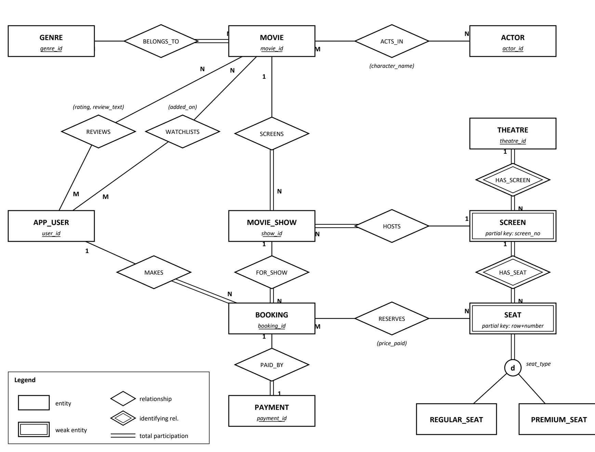

# Movie Discovery, Review & Cinema Booking Database 🎬

A database project that mixes **Letterboxd** (rate, review and watchlist movies) with **BookMyShow** (find shows and book cinema seats), built on **Oracle 21c**.

Right now people use one app to log the films they like and a totally different one to book tickets, so that data never ends up in the same place. We designed a single relational database for both halves, and we made the database itself enforce the important rules (like *a seat can't be sold twice for the same show*) using constraints, plus one trigger where a constraint wasn't enough.

---

## Team

| Name | ID No. | Contribution |
|------|--------|--------------|
| Sashwath Swaminathan | 2024A3PS0361H | ER/EER design, relational schema and table creation script (`02_create_tables.sql`) with all keys and constraints |
| Srujana N S | 2024A1PS0874H | Sample data population (`03_sample_data.sql`) and the SQL query set (`04_queries.sql`) |
| Anushka Sahoo | 2024A1PS0937H | Views (`05_views.sql`), booking-integrity trigger and test script (`06_booking_integrity.sql`) |
| Vinny Polamarasetty | 2024A1PS0930H | Normalization/design justification and the Database Design Document |
| Dhwaj Kishore | 2024A1PS1187H | Application Design (workflows, tech stack, architecture) and end-to-end testing / test report |

---

## Current progress (mid-sem)

- [x] Requirements, business rules and assumptions
- [x] ER/EER diagram, relational schema, normalization up to 3NF/BCNF
- [x] 15 tables with PK / FK / UNIQUE / NOT NULL / CHECK constraints
- [x] Sample data (8 users, 12 movies, 4 theatres, 84 seats, 12 shows, 12 bookings ...)
- [x] 37 SQL queries (joins, GROUP BY/HAVING, subqueries, EXISTS, double NOT EXISTS, set operators, CASE)
- [x] 5 views and a trigger that checks a booked seat belongs to the show's screen
- [x] Integrity test script: every invalid booking gets rejected with the right Oracle error
- [x] Everything tested end-to-end on Oracle 21c XE ([test report](docs/MovieDB_Oracle_Test_Report.pdf))
- [ ] PL/SQL procedures (`book_seats`, `cancel_booking`), a price function, indexes
- [ ] Web app: Node.js + Express backend, React frontend

---

## Tech stack

| Part | Tech |
|------|------|
| Database | Oracle Database 21c Express Edition, SQL, PL/SQL |
| Tools | SQL Developer, SQL*Plus |
| Backend *(planned)* | Node.js + Express, node-oracledb |
| Frontend *(planned)* | React (Vite) + Tailwind CSS |

---

## Documents

| Document | What's in it |
|----------|--------------|
| [Database Design Document](docs/Database_Design_Document.pdf) | ER/EER diagram, relational schema, keys, integrity constraints, assumptions, normalization |
| [Application Design](docs/Application_Design.pdf) | planned workflows, tech stack, architecture, API endpoints |
| [Test Report](docs/MovieDB_Oracle_Test_Report.pdf) | output of a full run on Oracle 21c, each query checked against its expected answer |
| [Design notes](01_design.md) | our full working notes (requirements, FDs, normalization walkthrough) |



---

## Repository structure

```
MovieDB_Oracle/
├── 01_design.md                 design notes (requirements, ER, schema, normalization)
├── 02_create_tables.sql         drops + creates all 15 tables, constraints, sequences
├── 03_sample_data.sql           sample data (+ a PL/SQL loop that generates the seats)
├── 04_queries.sql               37 queries, each with the expected result in a comment
├── 05_views.sql                 5 views + demo queries
├── 06_booking_integrity.sql     trigger + test script for invalid bookings (ends in ROLLBACK)
├── run_all.sql                  runs 02 -> 06 in SQL*Plus and saves the output to logs
├── report/                      scripts that re-run everything and build the test report
└── docs/                        PDFs + ER diagram (source code for the PDFs in docs/src)
```

---

## How to run it

**You need:** Oracle Database (we used 21c XE, free) and SQL Developer or SQL*Plus.

**1. Create a user for the project** (connect as SYSTEM to the pluggable DB `XEPDB1`):

```sql
CREATE USER moviedb IDENTIFIED BY "<your password>"
  DEFAULT TABLESPACE users QUOTA UNLIMITED ON users;
GRANT CREATE SESSION, CREATE TABLE, CREATE VIEW, CREATE SEQUENCE,
      CREATE TRIGGER, CREATE PROCEDURE TO moviedb;
```

**2. Run the scripts in this order** as `moviedb`:

| Order | File | What it does |
|-------|------|--------------|
| 1 | `02_create_tables.sql` | creates the tables (safe to re-run, it drops them first) |
| 2 | `03_sample_data.sql` | inserts the sample data and commits |
| 3 | `04_queries.sql` | runs the 37 queries |
| 4 | `05_views.sql` | creates the views |
| 5 | `06_booking_integrity.sql` | creates the trigger and runs the integrity tests (needs the views from step 4) |

- **SQL Developer:** open each file and press **Run Script (F5)**, not Run Statement (Ctrl+Enter). Keep auto-commit off, otherwise the savepoint demo in 06 won't behave as described.
- **SQL*Plus:** run everything in one go:

  ```
  sqlplus moviedb/<password>@localhost:1521/XEPDB1 @run_all.sql
  ```

  The output goes to `output_02_create_tables.log` ... `output_06_booking_integrity.log`.

**3. (Optional) Re-generate the test report.** Python 3 and `reportlab` are needed. Put your connection details in `oracle_credentials.txt` (this file is git-ignored), then:

```
python report/run_and_capture.py
python report/build_report.py
```

---

## Main workflows

**Done (database level):**

- **Browse movies:** see each movie's genres, cast and average rating (`MOVIE_DETAILS`, `MOVIE_RATING_SUMMARY` views).
- **Rate / review:** one review per user per movie, rating 0.5 to 5 in half stars (PK + CHECK).
- **Watchlist:** add movies to watchlist, find watchlisted movies that are currently showing (Q37).
- **Find shows:** what's playing where and when (`THEATRE_SHOW_SCHEDULE` view).
- **Book seats:** seat map per show (`SHOW_SEAT_STATUS` view). Double booking is blocked by `UNIQUE (show_id, seat_id)`, and the trigger stops seats from the wrong screen.
- **Payment:** one payment per booking; a SUCCESS payment must have a timestamp.

**Planned (web app):** the same flows as pages plus an admin page to add movies and shows. See the [Application Design](docs/Application_Design.pdf).

---

## A few design decisions we'd point out in the viva

- `USER` → `APP_USER` (reserved word in Oracle) and `SHOW` → `MOVIE_SHOW` (SQL*Plus command).
- `BOOKING_SEAT` keeps a copy of `show_id`. That's the only way a plain `UNIQUE (show_id, seat_id)` can stop double booking, and a composite FK makes sure the copy always matches the booking. Because of this the table is 3NF but not BCNF, and that's on purpose.
- No stored totals (screen capacity, booking total). They're calculated in views so they can never go out of date.
- `price_paid` is stored per seat because it's the price **at the time of booking**, not a duplicate of the show price.
