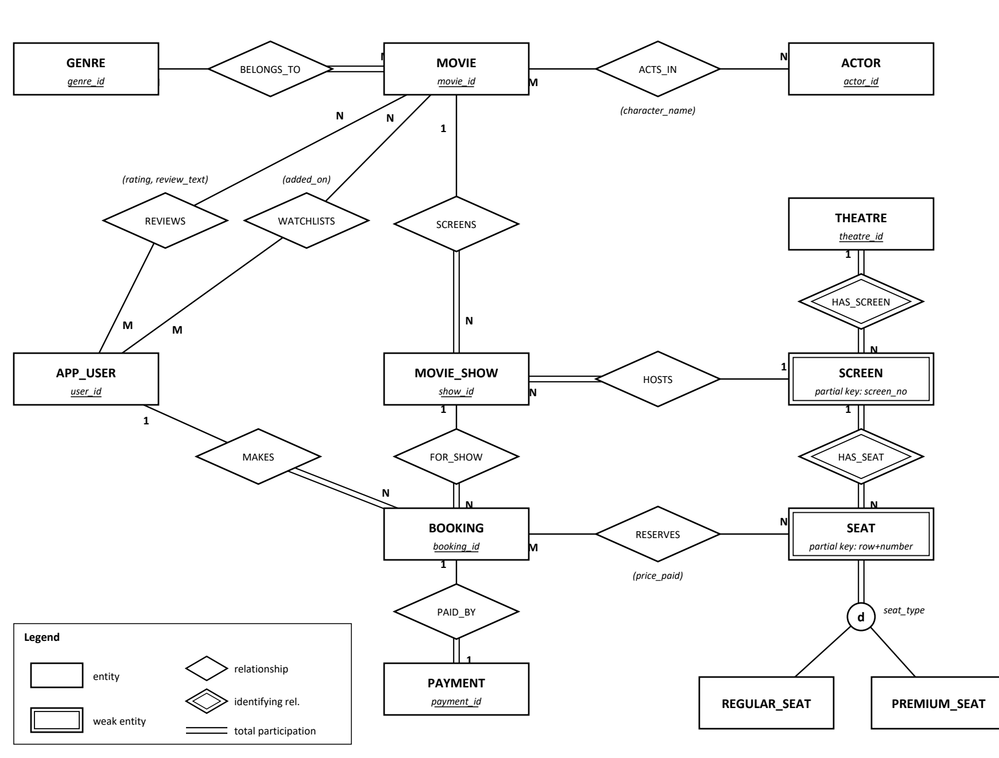

# Movie Discovery, Review & Cinema Booking Database 🎬

A database project that mixes **Letterboxd** (rate, review and watchlist movies) with **BookMyShow** (find shows and book cinema seats), built on **Oracle 21c**.

Right now people use one app to log the films they like and a totally different one to book tickets, so that data never ends up in the same place. We designed a single relational database for both halves, and we made the database itself enforce the important rules (like *a seat can't be sold twice for the same show*) using constraints, plus triggers and PL/SQL procedures where a constraint wasn't enough. A React + Express web app sits on top and calls those procedures, so every rule still lives in the database.

---

## Team

| Name | ID No. | Contribution |
|------|--------|--------------|
| Sashwath Swaminathan | 2024A3PS0361H | **Mid-sem:** ER/EER design, relational schema and table creation script (`02_create_tables.sql`) with all keys and constraints<br>**Final — booking & payment:** procedures `book_seats`, `make_payment`, `cancel_booking` (`07_plsql.sql`), the bookings API (`routes/bookings.js`) and the Seat map, Payment and My bookings pages |
| Vinny Polamarasetty | 2024A1PS0930H | **Mid-sem:** normalization/design justification and the Database Design Document<br>**Final — app shell & admin:** frontend setup, layout, shared components and the "acting as" user picker (`app/frontend`), the admin API (`routes/admin.js`) and Admin page, and the final Database Design Document |
| Srujana N S | 2024A1PS0874H | **Mid-sem:** sample data population (`03_sample_data.sql`) and the SQL query set (`04_queries.sql`)<br>**Final — browsing & reports:** functions `get_seat_price`, `get_avg_rating`, `seats_left` (`07_plsql.sql`), `08_upcoming_shows.sql`, the movies, shows and reports APIs and the Movies, Shows and Reports pages |
| Anushka Sahoo | 2024A1PS0937H | **Mid-sem:** views (`05_views.sql`), booking-integrity trigger and test script (`06_booking_integrity.sql`)<br>**Final — reviews & watchlist:** `save_review` procedure, watchlist trigger and `print_user_activity` cursor report (`07_plsql.sql`), the transaction demo (`09_plsql_demo.sql`), the watchlist API and the Movie and Watchlist pages |
| Dhwaj Kishore | 2024A1PS1187H | **Mid-sem:** Application Design (workflows, tech stack, architecture) and end-to-end testing / test report<br>**Final — backend core & testing:** Express server, connection pool and transactions (`server.js`, `db.js`), Oracle error messages (`errors.js`), lookup API (`routes/meta.js`), the foreign-key indexes and end-to-end testing of the web app |

---

## Progress

- [x] Requirements, business rules and assumptions
- [x] ER/EER diagram, relational schema, normalization up to 3NF/BCNF
- [x] 15 tables with PK / FK / UNIQUE / NOT NULL / CHECK constraints
- [x] Sample data (8 users, 12 movies, 4 theatres, 84 seats, 12 shows, 12 bookings ...)
- [x] 37 SQL queries (joins, GROUP BY/HAVING, subqueries, EXISTS, double NOT EXISTS, set operators, CASE)
- [x] 5 views and a trigger that checks a booked seat belongs to the show's screen
- [x] Integrity test script: every invalid booking gets rejected with the right Oracle error
- [x] Scripts 02–06 tested end-to-end on Oracle 21c XE ([test report](docs/MovieDB_Oracle_Test_Report.pdf))
- [x] PL/SQL: 3 functions, 5 procedures (`book_seats`, `make_payment`, `cancel_booking`, `save_review`, `print_user_activity`), a second trigger, 6 indexes
- [x] Transaction demo script: COMMIT, ROLLBACK, savepoints, all-or-nothing booking
- [x] Web app: Node.js + Express API (calls the PL/SQL procedures) and a React frontend

---

## Tech stack

| Part | Tech |
|------|------|
| Database | Oracle Database 21c Express Edition, SQL, PL/SQL |
| Tools | SQL Developer, SQL*Plus |
| Backend | Node.js + Express, node-oracledb (thin mode, no Oracle client install needed) |
| Frontend | React (Vite) + Tailwind CSS |

---

## Documents

| Document | What's in it |
|----------|--------------|
| [Database Design Document](docs/Database_Design_Document.pdf) | ER/EER diagram, relational schema, keys, integrity constraints, assumptions, normalization, indexes and PL/SQL design (4 pages) |
| [Application Design](docs/Application_Design.pdf) | workflows, tech stack, architecture, API endpoints (written before the app was built; the final endpoints are listed below) |
| [Test Report](docs/MovieDB_Oracle_Test_Report.pdf) | output of a full run on Oracle 21c, each query checked against its expected answer |
| [Design notes](01_design.md) | our full working notes (requirements, FDs, normalization walkthrough) |



---

## Repository structure

```
MovieDB_Oracle/
├── 01_design.md                 design notes (requirements, ER, schema, normalization)
├── 02_create_tables.sql         drops + creates all 15 tables, constraints, sequences
├── 03_sample_data.sql           sample data (+ a PL/SQL loop that generates the seats)
├── 04_queries.sql               37 queries, each with the expected result in a comment
├── 05_views.sql                 5 views + demo queries
├── 06_booking_integrity.sql     trigger + test script for invalid bookings (ends in ROLLBACK)
├── 07_plsql.sql                 indexes, functions, procedures, watchlist trigger
├── 08_upcoming_shows.sql        32 bookable shows for the next 4 days (relative to SYSDATE)
├── 09_plsql_demo.sql            PL/SQL + transaction demo (COMMIT / ROLLBACK / savepoints)
├── run_all.sql                  runs 02 -> 09 in SQL*Plus and saves the output to logs
├── app/
│   ├── backend/                 Express API (src/routes = one file per workflow)
│   └── frontend/                React + Vite + Tailwind (src/pages = one file per page)
├── report/                      scripts that re-run everything and build the test report
└── docs/                        PDFs + ER diagram (source code for the PDFs in docs/src)
```

---

## How to run it

**You need:** Oracle Database (we used 21c XE, free) and SQL Developer or SQL*Plus.

**1. Create a user for the project** (connect as SYSTEM to the pluggable DB `XEPDB1`):

```sql
CREATE USER moviedb IDENTIFIED BY "<your password>"
  DEFAULT TABLESPACE users QUOTA UNLIMITED ON users;
GRANT CREATE SESSION, CREATE TABLE, CREATE VIEW, CREATE SEQUENCE,
      CREATE TRIGGER, CREATE PROCEDURE TO moviedb;
```

**2. Run the scripts in this order** as `moviedb`:

| Order | File | What it does |
|-------|------|--------------|
| 1 | `02_create_tables.sql` | creates the tables (safe to re-run, it drops them first) |
| 2 | `03_sample_data.sql` | inserts the sample data and commits |
| 3 | `04_queries.sql` | runs the 37 queries |
| 4 | `05_views.sql` | creates the views |
| 5 | `06_booking_integrity.sql` | creates the trigger and runs the integrity tests (needs the views from step 4) |
| 6 | `07_plsql.sql` | indexes, functions, procedures and the second trigger |
| 7 | `08_upcoming_shows.sql` | adds shows for the next 4 days so there is something to book (run it again on demo day) |
| 8 | `09_plsql_demo.sql` | PL/SQL and transaction demo, every step has its expected output |

- **SQL Developer:** open each file and press **Run Script (F5)**, not Run Statement (Ctrl+Enter). Keep auto-commit off, otherwise the savepoint demo in 06 won't behave as described.
- **SQL*Plus:** run everything in one go:

  ```
  sqlplus moviedb/<password>@localhost:1521/XEPDB1 @run_all.sql
  ```

  The output goes to `output_02_create_tables.log` ... `output_09_plsql_demo.log`.

**3. Run the web app.** You need Node.js 18 or newer.

```
cd app/backend
cp .env.example .env          # then put your DB password in .env
npm install
npm start                     # API on http://localhost:4000

cd app/frontend               # in a second terminal
npm install
npm run dev                   # open http://localhost:5173
```

For the demo you can also build the frontend once (`npm run build` in `app/frontend`) and then `npm start` in the backend serves the whole app at http://localhost:4000.

**4. (Optional) Re-generate the test report.** Python 3 and `reportlab` are needed. Put your connection details in `oracle_credentials.txt` (this file is git-ignored), then:

```
python report/run_and_capture.py
python report/build_report.py
```

---

## Main workflows

**Database level:**

- **Browse movies:** see each movie's genres, cast and average rating (`MOVIE_DETAILS`, `MOVIE_RATING_SUMMARY` views).
- **Rate / review:** one review per user per movie, rating 0.5 to 5 in half stars (PK + CHECK).
- **Watchlist:** add movies to watchlist, find watchlisted movies that are currently showing (Q37).
- **Find shows:** what's playing where and when (`THEATRE_SHOW_SCHEDULE` view).
- **Book seats:** seat map per show (`SHOW_SEAT_STATUS` view). Double booking is blocked by `UNIQUE (show_id, seat_id)`, and the trigger stops seats from the wrong screen.
- **Payment:** one payment per booking; a SUCCESS payment must have a timestamp.

**Web app:** every workflow above is a page, plus an Admin page (add movies with their genres, schedule shows) and a Reports page that runs six of our queries live and shows their SQL. There is no login: pick which sample user you are "acting as" in the top-right drop-down.

| Method | Endpoint | Page / workflow | Database |
|--------|----------|-----------------|----------|
| GET | `/api/movies?q=&genre=&lang=&sort=` | Movies (W1) | `MOVIE_DETAILS`, `MOVIE_RATING_SUMMARY` |
| GET | `/api/movies/:id?userId=` | Movie page (W2) | views + `seats_left()` |
| PUT / DELETE | `/api/movies/:id/review` | Rate / review (W3) | `save_review` (MERGE), watchlist trigger |
| GET / POST / DELETE | `/api/watchlist` | Watchlist (W4) | `WATCHLIST` |
| GET | `/api/shows?city=&date=&movieId=` | Shows (W5) | `THEATRE_SHOW_SCHEDULE` |
| GET | `/api/shows/:id` | Seat map (W6) | `SHOW_SEAT_STATUS` |
| POST | `/api/bookings` | Book seats (W6) | `book_seats` |
| POST | `/api/bookings/:id/pay` | Payment (W7) | `make_payment` |
| GET | `/api/bookings?userId=` | My bookings (W8) | `BOOKING_SUMMARY` |
| POST | `/api/bookings/:id/cancel` | Cancel (W8) | `cancel_booking` |
| POST | `/api/admin/movies`, `/api/admin/shows` | Admin (W9) | INSERTs in one transaction |
| GET | `/api/reports` | Reports | six project queries |
| GET | `/api/users`, `/api/meta` | drop-downs | lookups |

## Demo

- Book the same seat for the same show from two browser windows (pick a different user in each). The second booking fails with "One or more of these seats is already booked for this show." and none of its seats get saved.
- Review a movie that's on your watchlist. It disappears from the watchlist (that's the trigger).
- In Admin, try adding a 400 minute movie, or two shows on the same screen at the same time. Oracle rejects it and the app shows the error.

## Design decisions

- We renamed USER to APP_USER and SHOW to MOVIE_SHOW because USER is reserved in Oracle and SHOW clashes with a SQL*Plus command.
- BOOKING_SEAT stores show_id even though BOOKING already has it. That lets UNIQUE (show_id, seat_id) block double booking, and a composite FK keeps it in sync with BOOKING. It makes the table 3NF instead of BCNF, which we were fine with.
- We don't store totals like screen capacity or booking amount. The views calculate them.
- price_paid is saved per seat because the show price can change later.
- The procedures don't COMMIT. The backend commits once the whole request works, or rolls back.
- book_seats doesn't check if a seat is free first. It just inserts and lets the UNIQUE constraint catch it, which also handles two people booking at the same time.
- The backend doesn't re-check rules. It just shows the error Oracle gives back.
